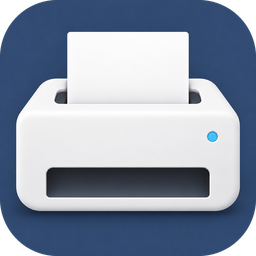

<p align="center"></p>

<h1 align="center">SpliX for macOS</h1>

<p align="center"><b>Keep your printer. Upgrade your Mac.</b><br>
Native printing for supported Samsung, Xerox and Dell laser printers on macOS 27 and Apple Silicon. No Rosetta required.</p>

<p align="center">
<a href="https://github.com/boredjar-com/splix-macos/releases/latest">Download for macOS</a> ·
<a href="docs/SUPPORTED-PRINTERS.md">Check your printer</a> ·
<a href="https://github.com/boredjar-com/splix-macos/issues">Get help</a> ·
<code>brew install --cask boredjar-com/tap/splix-macos</code>
</p>

---

<sub><b>Searching for:</b> Samsung printer driver macOS 27 · Samsung ML-2160 macOS · "Filter failed" · <code>com.apple.badarch-error</code> ·
Rosetta removed · Apple Silicon M1 M2 M3 M4 · CUPS filter arm64 · SPL QPDL · rastertoqpdl ·
Samsung ML-1640 ML-1660 ML-1670 ML-2010 ML-2165 ML-2240 ML-2250 ML-2510 ML-2525 ML-3310 · SCX-4200 SCX-4300 SCX-4600 SCX-4623 ·
CLP-310 CLP-315 CLP-600 CLX-3160 CLX-3175 · Xerox Phaser 3117 3124 3140 · Dell 1100 1110 · AirPort Express USB printer sharing · open source · GPL</sub>

Native **universal (arm64 + x86_64)** CUPS driver for Samsung laser printers (and their Xerox,
Dell, Toshiba and Lexmark rebadges) that speak **SPL / QPDL**. 82 printer models.
No Rosetta, no Ghostscript, no Homebrew: Xcode's clang and Apple's own CUPS are enough.

Full model list: [docs/SUPPORTED-PRINTERS.md](docs/SUPPORTED-PRINTERS.md).

---

## The problem this solves

macOS 27 removed Rosetta 2. Samsung's official macOS printer driver (last updated years ago,
Samsung's printer division was sold to HP in 2017) ships **Intel-only** CUPS filters:
`rastertosec`, `pstosecps`, `commandtosec`, `prefilter` are i386 + x86_64 Mach-O binaries.
On macOS 27 every job fails:

```
printer-state-message="Filter failed"
printer-state-reasons=com.apple.badarch-error
```

Nobody will ship a fix. Unofficial workarounds (hacking the Samsung installer to pass the OS
version check) worked up to macOS 26 only because Rosetta still ran the Intel filter.

This repository replaces the vendor filter with the open-source **SpliX** `rastertoqpdl`
filter compiled natively for Apple Silicon, with **JBIG-KIT** linked statically (needed by the
CLP/CLX colour models), and rewrites the SpliX PPDs so that Apple's built-in `cgpdftoraster`
feeds the filter:

```
PDF ──▶ cgpdftoraster (Apple) ──▶ rastertoqpdl (this project) ──▶ usb:// | socket:// | riousbprint:// ──▶ printer
                                                                      (all three verified)
```

Verified on **macOS 27.0.1 (Apple Silicon)** with a **Samsung ML-2160**, both over **USB** and
shared by an **AirPort Express** (Bonjour `_pdl-datastream._tcp`, raw port 9100).
Details: [docs/ROOT-CAUSE.md](docs/ROOT-CAUSE.md) and [docs/TESTING.md](docs/TESTING.md).

## Install (no Terminal needed)

1. Switch the printer on and connect it (USB, or shared by an AirPort Express / Time Capsule).
2. Download `SpliX-macOS-<version>.pkg` from [Releases](../../releases) and double-click it.
   The installer explains what it does, installs the driver and **adds your printer
   automatically** (it also repairs printers macOS had already added with the broken
   Samsung driver).
3. Print from any app. Done.

The package is signed with a Developer ID certificate (BORED JAR SL) and notarized by Apple,
so it opens with a plain double-click, no Gatekeeper warning. Everything inside is open source
and reproducible from this repository; the CI build log of each release is public.

If the printer was not connected during installation, either run the installer again later or
add it by hand: **System Settings → Printers & Scanners → Add Printer…**, select it, and under
**Use** pick **Select Software…**, type `SpliX` and choose your model, e.g. **Samsung ML-2160
(SpliX)**. If the old Samsung driver is still installed, macOS auto-selects *its* PPD when a USB
printer is plugged in; pick the `(SpliX)` entry instead, or run
`sudo /Library/Printers/SpliX/splix-autosetup.sh` which fixes such queues.

### Terminal alternative

```bash
brew install --cask boredjar-com/tap/splix-macos                 # Homebrew users
sudo installer -pkg SpliX-macOS-2.0.1-macos2.pkg -target /       # same as double-click
sudo /Library/Printers/SpliX/splix-autosetup.sh --dry-run        # show what would be added
lpadmin -p Samsung_ML-2160 -E -v socket://AirPort-Express.local:9100 \
  -P /Library/Printers/PPDs/Contents/Resources/SpliX-ml2160.ppd.gz -o PageSize=A4   # manual
```

## Uninstall

Everything the installer added is removed with one of these (print queues, filter, PPDs,
installer receipt):

```bash
sudo /Library/Printers/SpliX/splix-uninstall.sh     # installed by the .pkg
brew uninstall --cask splix-macos                   # if you installed through Homebrew
sudo ./macos/uninstall.sh                           # from a checkout of this repository
```

## Build from source

Requirements: Xcode or the Command Line Tools. Nothing else.

```bash
./macos/build.sh                 # build/rastertoqpdl (universal) + build/ppds/*.ppd.gz, validates PPDs
./tests/smoke.sh                 # offline: PDF → CUPS raster → QPDL for all 82 PPDs, no printer needed
sudo ./macos/install.sh          # installs filter + PPDs system-wide and restarts cupsd
sudo ./macos/install.sh --add-printer Samsung_ML-2160 socket://AirPort-Express.local:9100 ml2160
./macos/make-pkg.sh 2.0.1-macos2 # build/SpliX-macOS-2.0.1-macos2.pkg (double-click installer)
./macos/sign-notarize.sh 2.0.1-macos2   # maintainers: Developer ID build + notarization + stapling
```

Install locations: `/Library/Printers/SpliX/rastertoqpdl` and
`/Library/Printers/PPDs/Contents/Resources/SpliX-*.ppd.gz` (flat: Apple's `cups-driverd` does not scan subfolders).

## Repository layout

| Path | Purpose |
|------|---------|
| `third_party/splix-2.0.1/` | SpliX 2.0.1 sources and PPDs, **unmodified** (GPL-2.0) |
| `third_party/jbigkit-2.1/libjbig/` | JBIG-KIT 2.1, `libjbig85` only, **unmodified** (GPL-2.0-or-later) |
| `macos/Makefile` | universal build of `rastertoqpdl`, ad-hoc code-signed |
| `macos/gen-ppds.sh` | PPD rewrite for macOS: absolute filter path, `(SpliX)` NickName, `1284DeviceID` for Samsung models |
| `macos/splix-autosetup.sh` | detects Samsung printers (USB / Bonjour), creates queues with the right PPD, repairs vendor-driver queues; run by the installer |
| `macos/make-pkg.sh` · `macos/pkg/` | double-click installer: component pkg + welcome / license / conclusion panes |
| `macos/sign-notarize.sh` | Developer ID signing + notarization + stapling of the `.pkg` |
| `macos/install.sh` · `uninstall.sh` | script-based install and removal for developers |
| `tests/smoke.sh` | end-to-end offline test across every PPD |
| `scripts/gen-supported-list.sh` | regenerates `docs/SUPPORTED-PRINTERS.md` |
| `docs/` | root-cause analysis, supply-level investigation, troubleshooting, verification log |

## Supply levels (toner)

**Not available** on low-end Samsung engines such as the ML-2160, over USB or through an
AirPort Express, and System Settings says "Information not available". The engine implements
PJL as a stub (`@PJL INFO STATUS` returns an empty body), has no SNMP, and Samsung's own driver
read toner through proprietary USB control transfers outside the printer class interface.
Investigation and raw captures: [docs/SUPPLY-LEVELS.md](docs/SUPPLY-LEVELS.md).
The printer's own configuration report page (see the printer manual) still shows toner.

## Troubleshooting

See [docs/TROUBLESHOOTING.md](docs/TROUBLESHOOTING.md). Short version:

```bash
cupsctl --debug-logging          # print once, then:
grep -a 'Job ' /var/log/cups/error_log | grep -iE 'SpliX|rastertoqpdl|ERROR|badarch'
cupsctl --no-debug-logging
```

## Known limitations

* **PPD drivers are deprecated by Apple.** `lpadmin` on macOS 27 warns that printer drivers
  "will stop working in a future version of CUPS". They work today. If Apple removes the PPD
  path, the plan is an IPP Everywhere / AirPrint bridge daemon that reuses this exact filter.
* Colour CLP/CLX models: SpliX's colour profiles were applied by `pstoqpdl` through Ghostscript
  on Linux; on macOS the raster path skips them. Printing works, colours are uncorrected.
* No toner level / status reporting (see above).

## Contributing

Tested a model? Found a bug? See [CONTRIBUTING.md](CONTRIBUTING.md) and use the issue template.
Please include `macOS version`, `printer model`, `connection (USB / AirPort / IP)` and the
`error_log` excerpt.

## License

**GPL-2.0-only** for the whole repository. SpliX is GPL-2.0 and JBIG-KIT is GPL-2.0-or-later;
a combined work must therefore be distributed under GPL-2.0. Free as in freedom and as in beer.

## Credits

Packaged and maintained by [Bored Jar](https://github.com/boredjar-com). Built in one evening
with Claude Code once the printer stopped working on macOS 27.


* [SpliX](http://splix.ap2c.org) — Aurélien Croc (AP²C) and contributors. All the hard
  QPDL work is theirs.
* [JBIG-KIT](https://www.cl.cam.ac.uk/~mgk25/jbigkit/) — Markus Kuhn.
* Debian `printer-driver-splix` maintainers for keeping the 2.0.1 tarball alive.
